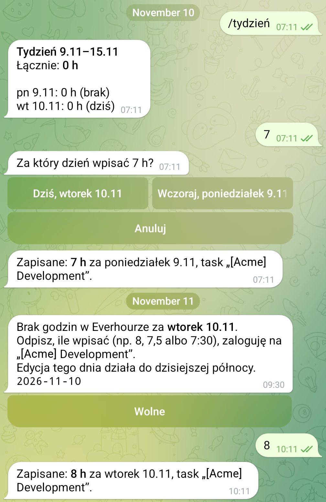
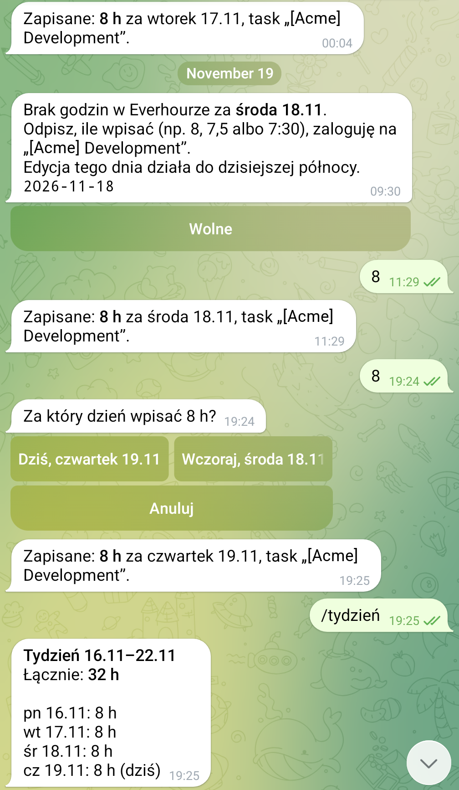
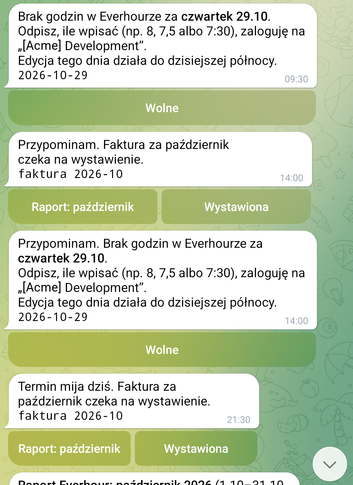

# Everhour + Telegram: bot do pilnowania godzin (n8n)

Workflow n8n, który sprawdza, czy poprzedni dzień roboczy ma wpisane godziny w [Everhourze](https://everhour.com), przypomina o brakach na Telegramie i wpisuje godziny za Ciebie, gdy odpiszesz liczbą. Do tego raport tygodniowy i miesięczny oraz przypomnienie o fakturze na koniec miesiąca.

*An n8n workflow that reminds you on Telegram about missing Everhour time entries and logs the hours you reply with. The bot talks Polish. [English README](README.md).*

## Co robi

- Trzy razy dziennie (9:30, 14:00, 21:30) sprawdza wczorajszy dzień roboczy. Pisze tylko wtedy, gdy godzin brakuje albo wyglądają podejrzanie (mniej niż 6 h, więcej niż 10 h).
- Odpisujesz liczbą godzin, bot uzupełnia wpis w Everhourze tak, żeby suma za dzień się zgadzała.
- Dni wolne oznaczasz jednym słowem albo przyciskiem, także z wyprzedzeniem („0 do piątku”).
- `/tydzien` i `/raport` pokazują sumy prosto z raportów Everhoura.
- Przed ostatnim dniem roboczym miesiąca przypomina o fakturze i podsuwa raport za ten miesiąc.

Jeden workflow obsługuje jedną osobę: jeden klucz API Everhoura, jeden bot, jeden czat. Każdy stawia własną kopię.

## Jak to wygląda

<p>
  
  
  
</p>

Od lewej: przypomnienie i wpis godzin, wpis bez przypomnienia z podsumowaniem tygodnia, przypomnienie o fakturze. Nazwy tasków na zrzutach są przykładowe.

## Wymagania

- n8n z funkcją Data tables (n8n Cloud albo self-hosted z publicznym adresem HTTPS, którego wymaga Telegram Trigger).
- Konto w Everhourze i własny klucz API.
- Telegram.

Zużycie: około 90 uruchomień miesięcznie z harmonogramu plus jedno na każdą Twoją wiadomość lub kliknięcie przycisku.

## Instalacja

1. **Data tables.** W n8n utwórz dwie tabele. Nazwy tabel i kolumn muszą być dokładnie takie:

   | Tabela | Kolumny |
   |---|---|
   | `everhour_reminders` | `date` (string), `status` (string), `hours` (number), `pings` (number), `note` (string) |
   | `invoice_reminders` | `period` (string), `status` (string), `pings` (number), `note` (string) |

2. **Credentiale.** Utwórz dwa, najlepiej pod tymi nazwami:
   - `Everhour API key`, typ **Header Auth**: Name = `X-Api-Key`, Value = klucz API z Everhoura (profil użytkownika, na dole strony).
   - `Telegram: Everhour bot`, typ **Telegram API**: token nowego bota z [@BotFather](https://t.me/BotFather) (`/newbot`).
3. **Import.** Nowy workflow → *Import from File* → [`workflow.json`](workflow.json).
4. **Podpięcie credentiali.** Przejdź po node'ach z ostrzeżeniem i wybierz właściwy credential: `Everhour API key` w node'ach „Everhour: …”, `Telegram: Everhour bot` w node'ach Telegrama.
5. **Publikacja.** Opublikuj (aktywuj) workflow i napisz do swojego bota `/start`. Bot odpowie Twoim `chat_id`.
6. **Config.** Wklej `chat_id` w node **Config** → `TELEGRAM_CHAT_ID` i opublikuj ponownie. Od tej chwili bot odpowiada tylko na tym czacie, pozostałe ignoruje.
7. **Test.** Wyślij `/status`. Powinieneś zobaczyć swój profil z Everhoura, politykę blokady i ostatnie 7 dni.

### Config

| Pole | Domyślnie | Znaczenie |
|---|---|---|
| `TELEGRAM_CHAT_ID` | puste | Jedyny czat, który bot obsługuje. |
| `MIN_HOURS` / `MAX_HOURS` | 6 / 10 | Suma za dzień poza tym zakresem wywołuje pytanie, czy tak ma być. |
| `LOCK_DAYS` | 2 | Ile dni, licząc z dzisiejszym, Everhour pozwala edytować (2 = dziś i wczoraj). Sprawdź w `/status`, jaką politykę ma Twój zespół. |
| `EVERHOUR_TASK_ID` | puste | Task, na który bot loguje godziny. Puste = task, na którym miałeś najwięcej czasu w 14 dniach przed danym dniem. |
| `INVOICE_REMINDERS` | true | `false` wyłącza przypomnienia o fakturze. |

## Instrukcja obsługi

### Przypomnienia

Bot sprawdza **wczoraj**, o ile był to dzień od poniedziałku do piątku. Piątek sprawdza w sobotę. Pisze, gdy:

- nie ma żadnych godzin: prosi o liczbę, pod wiadomością jest przycisk **Wolne**;
- suma jest poniżej `MIN_HOURS` albo powyżej `MAX_HOURS`: pyta, czy tak ma być, pod wiadomością jest przycisk **OK, zostaw**;
- nie może połączyć się z Everhourem: przypomina na wszelki wypadek.

Jeśli nie zareagujesz, ponawia o 14:00 i 21:30. Milknie, gdy odpowiesz albo gdy godziny pojawią się w Everhourze inną drogą. Dzień, który został bez godzin i wypadł z okna edycji, dostaje jedną wiadomość z informacją, że trzeba go odblokować u administratora.

### Odpowiedzi

| Piszesz | Co się dzieje |
|---|---|
| `8`, `7,5`, `7:30`, `7h30`, `450 min` | Łączna liczba godzin za dzień. Tekst po liczbie trafia do komentarza wpisu, np. `8 deploy i review`. Maksymalnie 16 h. |
| `0`, `wolne`, `urlop`, `L4`, `chorobowe`, `off` | Dzień wolny: nic nie trafia do Everhoura, przypomnienia ustają. Tekst po słowie zostaje w notatce, np. `0 L4`. |
| `ok`, `zostaw` | Zostaw wpis bez zmian i nie przypominaj. |
| `0 do piątku`, `L4 do 16.10`, `wolne do jutra`, `urlop do końca tygodnia` | Wolne na kilka dni: od dziś (w odpowiedzi na przypomnienie od jego dnia) do podanego dnia, tylko pn–pt, najwyżej 45 dni naprzód. |
| `wracam` | Odwołuje zaplanowane wolne od dziś. |

**Którego dnia dotyczy odpowiedź.** Jeśli odpowiadasz funkcją „Odpowiedz” na konkretne przypomnienie albo klikasz jego przycisk, to tego dnia. W innym wypadku najnowszego otwartego przypomnienia. Jeśli żadnego nie ma, bot zapyta: dziś czy wczoraj. Godzin nie da się wpisać z wyprzedzeniem ani za dzień poza oknem edycji.

**Jak bot wpisuje godziny.** Podana liczba to suma za cały dzień. Bot zmienia tylko wpis na głównym tasku (z `EVERHOUR_TASK_ID` albo wybranym automatycznie) i ustawia go tak, żeby razem z wpisami na innych taskach dał tę sumę. Odmówi i poprosi o ręczną poprawkę, gdy inne taski same dają już tyle lub więcej albo gdy główny task ma tego dnia kilka wpisów. Po zapisie potwierdza sumę i nazwę taska.

### Komendy

| Komenda | Wynik |
|---|---|
| `/status` | Profil z Everhoura, strefa czasowa, polityka blokady, ostatnie 7 dni, zaplanowane wolne. |
| `/tydzien` | Godziny w bieżącym tygodniu z rozbiciem na dni. `/tydzien poprzedni` pokazuje zeszły. |
| `/raport` | Raport za poprzedni miesiąc z podziałem na projekty. Inny miesiąc: `/raport bieżący`, `/raport 9`, `/raport wrzesień`, `/raport 2026-09`. |
| `/help` | Ściąga w czacie. |

Sumy w raportach pochodzą z raportów Everhoura i bot ich nie przelicza. Gdy Everhour raportu nie zwróci, bot napisze to wprost zamiast liczyć sam.

### Faktura

Termin to ostatni dzień roboczy (pn–pt) miesiąca. Bot uprzedza dzień wcześniej o 9:30, a od dnia terminu przypomina przy każdym przebiegu, także w weekend i w kolejnym miesiącu, aż odpiszesz `wystawiona` albo klikniesz **Wystawiona**. Przycisk **Raport: miesiąc** od razu pokazuje godziny do faktury. Fakturę wystawioną przed terminem możesz odhaczyć najwcześniej 7 dni przed nim.

## Ograniczenia

- Strefa czasowa `Europe/Warsaw` i godziny przypomnień są wpisane na stałe (node **Schedule** i stała `ZONE` w node'ach Code).
- Dni robocze to pn–pt. Świąt bot nie zna: na przypomnienie po święcie odpowiedz `wolne`.
- Rytm przypomnień zakłada, że Everhour blokuje edycję po dwóch dniach. Przy innej polityce ustaw `LOCK_DAYS`, a w razie potrzeby zmień harmonogram.

## Rozwój

Kod node'ów Code leży w [`nodes/`](nodes), a `workflow.json` jest z niego generowany.

```bash
npm install
npm test         # testy logiki: daty, parser odpowiedzi, plan zapisu, raporty, faktura
npm run build    # składa workflow.json z nodes/*.js
npm run e2e      # test end-to-end na jednorazowym n8n (wymaga Dockera i openssl)
```

Po zmianie logiki: edytuj `nodes/*.js`, uruchom testy, zbuduj i zaimportuj `workflow.json` albo wklej kod do odpowiedniego node'a w n8n.

### Test end-to-end

`npm run e2e` stawia n8n w kontenerze, importuje `workflow.json` dokładnie w tej postaci, w jakiej leży w repo, i rozmawia z botem tak, jak robi to Telegram: wysyła wiadomości i kliknięcia na webhook, a potem sprawdza, co bot odpisał i co zapisał w Everhourze. Po teście kontenery znikają.

- Everhoura i Telegram udaje [`ci/e2e/mock.js`](ci/e2e/mock.js). Kontenery działają w wewnętrznej sieci Dockera bez wyjścia do internetu, w której `api.everhour.com` i `api.telegram.org` wskazują na atrapę, więc test nie dotknie prawdziwych kont. Klucze w teście są zmyślone.
- Przebiegi z harmonogramu są wywoływane z ustaloną datą przez dodatkowe wejście, które test dokleja przed node **Config**. Reszta workflow zostaje nietknięta.
- Atrapa odwzorowuje tylko te odpowiedzi Everhoura i Telegrama, z których workflow korzysta. Zmiany po stronie prawdziwych API test nie wykryje.
- Wersja n8n jest przypięta w [`ci/e2e/run.js`](ci/e2e/run.js). Inną sprawdzisz przez `N8N_IMAGE=n8nio/n8n:latest npm run e2e`.

### CI

[GitHub Actions](.github/workflows/ci.yml) uruchamia przy każdym pushu do `main` i w pull requestach:

- testy logiki i sprawdzenie, czy `workflow.json` odpowiada kodowi w `nodes/`;
- skan sekretów w całej historii (gitleaks) oraz, jeśli w repo ustawiono sekret `FORBIDDEN_WORDS` (wyrażenie regularne), skan historii pod kątem nazw, które nie powinny trafić do publicznego repo;
- test end-to-end na przypiętej wersji n8n.

Raz w tygodniu ten sam test end-to-end biegnie dodatkowo na najnowszym n8n.

## Licencja

[MIT](LICENSE)
